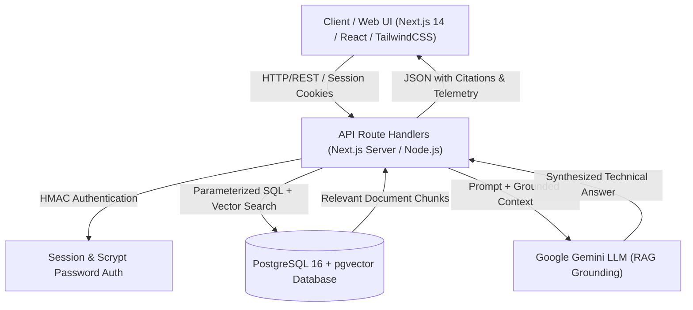
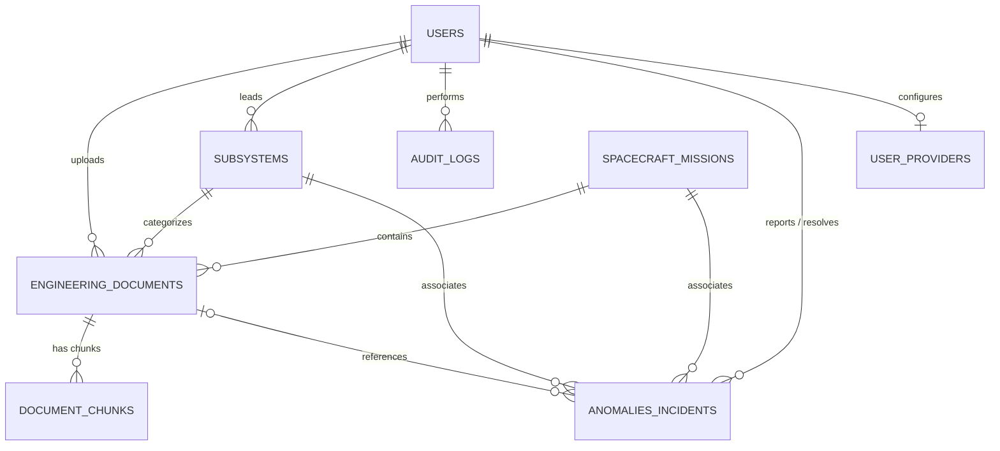

# COSMOS: Spacecraft Engineering Knowledge Workspace
## Advanced DBMS & Semantic Retrieval System (RAG + pgvector)

**GitHub Repository:** [shanmugavel30072006-blip/DBMS_RAG](https://github.com/shanmugavel30072006-blip/DBMS_RAG)

---

## 1. Executive Summary & Project Overview

**COSMOS (AstroRAG)** is an enterprise-grade spacecraft engineering knowledge management workspace. Spacecraft telemetry specs, flight manuals, anomaly reports, and subsystem procedures are typically voluminous, technical, and critical to real-time operations. 

This project integrates a **dual-paradigm database architecture**:
1. **Relational Database Management System (RDBMS)**: High-integrity SQL models for mission profiles, subsystems, documents, anomaly registers, user accounts, and immutable audit logs.
2. **Vector Database Paradigm (pgvector)**: 384-dimensional dense vector embeddings with Hierarchical Navigable Small World (HNSW) indexing for sub-millisecond semantic retrieval across technical document chunks.
3. **Retrieval-Augmented Generation (RAG)**: Synthesizes retrieved engineering document chunks with Google Gemini LLMs to produce citation-grounded operational insights.

---

## 2. System Architecture



---

## 3. Database Schema & Data Dictionary

The project implements a relational schema within PostgreSQL with extensions `vector` and `uuid-ossp`.

### 3.1 Entity Relationship Diagram



### 3.2 Relational Tables Summary

| Table | Description | Primary Key & Constraints |
| :--- | :--- | :--- |
| **`users`** | Authentication credentials & profile data | `user_id SERIAL PK`, `username UNIQUE`, `password_hash` (`scrypt`) |
| **`spacecraft_missions`** | Spacecraft missions (e.g. Artemis, Europa Clipper) | `mission_id SERIAL PK`, `mission_code UNIQUE`, `status CHECK` |
| **`subsystems`** | Spacecraft engineering disciplines (Avionics, Propulsion) | `subsystem_id SERIAL PK`, `code UNIQUE`, `lead_engineer_id FK users` |
| **`engineering_documents`** | Master technical documents, flight rules, procedures | `document_id SERIAL PK`, `doc_type CHECK`, `status CHECK` |
| **`document_chunks`** | Windowed text chunks & vector embeddings | `chunk_id UUID PK`, `embedding vector(384)`, `FK document_id CASCADE` |
| **`anomalies_incidents`** | Mission anomaly log and technical root-cause tracking | `anomaly_id SERIAL PK`, `anomaly_code UNIQUE`, `severity CHECK` |
| **`audit_logs`** | Tamper-evident operational audit trail | `log_id BIGSERIAL PK`, `timestamp TIMESTAMPTZ`, `details JSONB` |
| **`user_providers`** | Encrypted per-user Gemini API keys & provider settings | `user_id PK FK users`, `encrypted_key (AES-256-GCM)` |

---

## 4. Advanced DBMS Features Implemented

### 4.1 Vector Semantic Search Function
* **Definition**: `match_spacecraft_knowledge(query_embedding, match_threshold, match_count, filter_subsystem_id, filter_mission_id)`
* **Technique**: Cosine distance operator (`<=>`) over 384-dimensional embeddings combined with relational filtering.
* **HNSW Indexing**:
  ```sql
  CREATE INDEX idx_document_chunks_embedding_hnsw 
  ON document_chunks 
  USING hnsw (embedding vector_cosine_ops)
  WITH (m = 16, ef_construction = 64);
  ```

### 4.2 Automated Database Triggers
* **`trg_audit_document_lifecycle`**: Triggered `BEFORE INSERT OR UPDATE` on `engineering_documents`. Automatically records an audit event in `audit_logs` capturing status changes, revision numbers, and chunk counts as structured JSONB.
* **`trg_update_anomaly_ts`**: Triggered `BEFORE UPDATE` on `anomalies_incidents` to enforce accurate `updated_at` timestamps upon incident resolution.

### 4.3 Database Views (Multi-Table Aggregations)
1. **`vw_subsystem_readiness_summary`**: Aggregates document counts, total indexed chunks, and active/critical anomalies per engineering division using `COUNT(...) FILTER (WHERE ...)`.
2. **`vw_document_vector_stats`**: Summarizes chunk distribution, token volumes, and vectorization status per document.
3. **`vw_anomaly_impact_matrix`**: Cross-tabulates anomalies by mission, subsystem, severity, and resolution timeframe.

### 4.4 Complex & Nested Queries
* **Correlated Subquery (`database/seed.sql`)**:
  ```sql
  UPDATE engineering_documents d
  SET chunk_count = (
      SELECT COUNT(*) 
      FROM document_chunks c 
      WHERE c.document_id = d.document_id
  );
  ```
* **Dashboard Metric Subqueries (`lib/db.ts`)**: Single-roundtrip cross-table scalar subqueries calculating document, chunk, token, and active incident metrics.

---

## 5. Security & Authentication Architecture

1. **Password Security**: Passwords are never stored in plaintext. They are salted with 16 bytes of cryptographically secure random bytes and hashed using `scrypt` with a 64-byte derived key.
2. **Stateless Session Tokens**: Authenticated sessions are encoded using HMAC-SHA256 signed tokens stored inside `httpOnly`, `sameSite: 'lax'` secure cookies.
3. **API Key Encryption at Rest**: Per-user Gemini API keys are encrypted at rest using **AES-256-GCM** with unique initialization vectors (IVs) and authentication tags.

---

## 6. Deployment & Verification

* **Containerization**: Full-stack orchestration via `docker-compose.yml` deploying Next.js and PostgreSQL 16 with pre-compiled `pgvector`.
* **Database Health**: Real-time health endpoint at `/api/health` verifying active database connection and pgvector extension status.
* **Source Control**: Clean, modular Git repository maintained at [shanmugavel30072006-blip/DBMS_RAG](https://github.com/shanmugavel30072006-blip/DBMS_RAG).

---

## 7. Conclusion

The Cosmos project successfully bridges enterprise relational database principles with modern AI information retrieval. By combining ACID-compliant transactions, foreign key cascades, triggers, and views with pgvector embeddings and LLM grounding, it provides a performant, traceable, and secure engineering platform.
