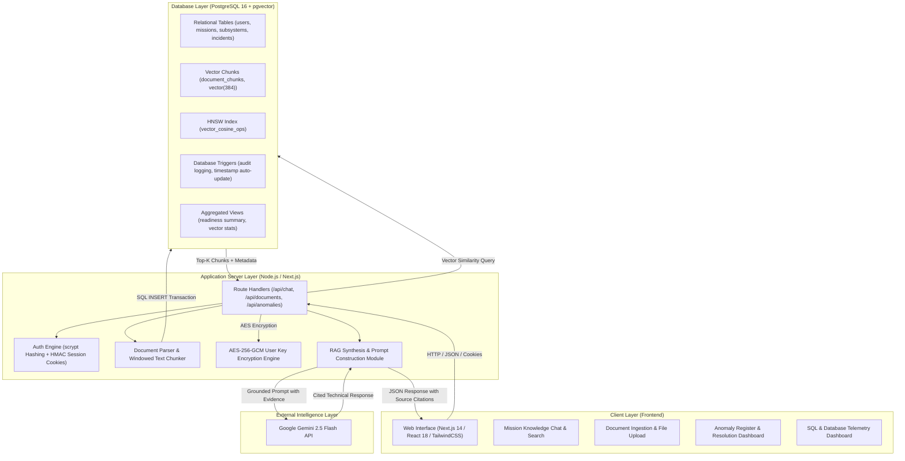
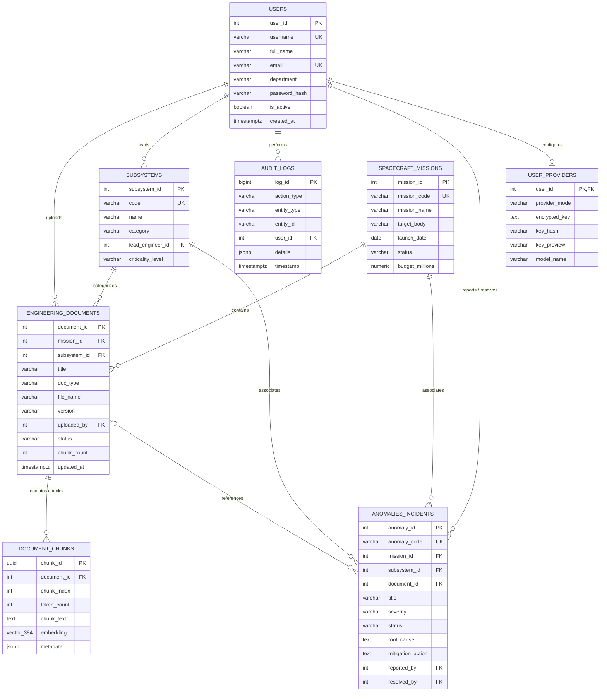
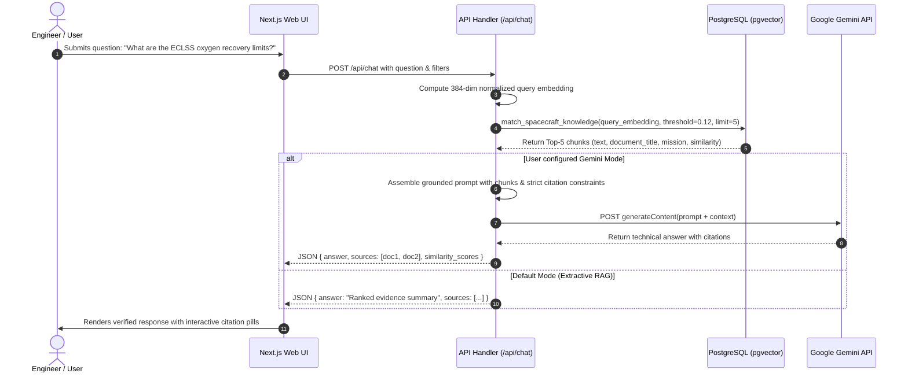

# Comprehensive Project & Academic Report
# COSMOS: Spacecraft Engineering Knowledge Management & Intelligent Retrieval System
## Dual-Paradigm Architecture: PostgreSQL Relational Integrity + pgvector Semantic Retrieval + LLM RAG Synthesis

**Repository URL:** [https://github.com/shanmugavel30072006-blip/DBMS_RAG](https://github.com/shanmugavel30072006-blip/DBMS_RAG)  
**Author / Maintainer:** Shanmugavel (`shanmugavel30072006-blip`)  
**Technology Stack:** PostgreSQL 16, pgvector 0.8.7, Next.js 14, Node.js 22, TypeScript, TailwindCSS, Docker, Google Gemini 2.5  

---

## Table of Contents
1. [Abstract & Executive Summary](#1-abstract--executive-summary)
2. [Problem Statement & Operational Objectives](#2-problem-statement--operational-objectives)
3. [End-to-End System Architecture](#3-end-to-end-system-architecture)
4. [Dual-Paradigm Database Design](#4-dual-paradigm-database-design)
   - 4.1 Relational Architecture & ACID Compliance
   - 4.2 Vector Paradigm (pgvector & HNSW)
5. [Entity-Relationship Model & Complete Data Dictionary](#5-entity-relationship-model--complete-data-dictionary)
6. [Advanced Database Features Implementation](#6-advanced-database-features-implementation)
   - 6.1 Stored Functions: Vector Distance & Similarity Search
   - 6.2 Automated Database Triggers & Audit Logging
   - 6.3 Aggregated Multi-Table Relational Views
   - 6.4 Complex Queries, Grouping, & Nested Subqueries
7. [Retrieval-Augmented Generation (RAG) Pipeline](#7-retrieval-augmented-generation-rag-pipeline)
8. [Security, Cryptography, & Role Governance](#8-security-cryptography--role-governance)
9. [Deployment, Containerization, & Health Verification](#9-deployment-containerization--health-verification)
10. [Test Cases, Execution Results, & Validation](#10-test-cases-execution-results--validation)
11. [Conclusion, Limitations, & Future Roadmap](#11-conclusion-limitations--future-roadmap)

---

## 1. Abstract & Executive Summary

Spacecraft operations and aerospace engineering generate massive volumes of documentation across mission lifecycles—including flight manuals, telemetry specifications, system architectural designs, anomaly registers, and contingency procedures. In high-consequence operational scenarios, finding precise, verified engineering guidance across hundreds of thousands of pages is hindered by fragmentation, keyword-search limitations, and strict mission security controls.

**COSMOS (AstroRAG)** is an enterprise knowledge management and intelligent retrieval workspace built on a unified **Dual-Paradigm Database Architecture**. Rather than separating relational business logic and vector search into isolated services, COSMOS integrates standard relational tables with dense vector storage inside a single **PostgreSQL 16** engine using the **pgvector** extension. 

By unifying relational constraints, foreign keys, triggers, and views with high-speed HNSW (Hierarchical Navigable Small World) cosine distance indexing, COSMOS enables sub-millisecond semantic retrieval across technical documents. These retrieved chunks are synthesized through a server-mediated Retrieval-Augmented Generation (RAG) pipeline powered by Google Gemini, guaranteeing grounded answers with explicit document citations while enforcing tamper-evident auditability.

---

## 2. Problem Statement & Operational Objectives

### 2.1 The Operational Challenge
In spacecraft mission control and engineering environments:
- **High Information Density & Fragmentation:** Telemetry formats, orbital maneuvers, and subsystem constraints are scattered across PDFs, Word documents, text memos, and legacy incident logs.
- **Failures of Lexical (Keyword) Search:** Engineering queries often use functional descriptions (e.g., *"thruster valve pressure drop during lunar insertion"*) rather than exact technical keywords matching every manual.
- **Loss of Relational Context:** Pure vector databases fail to enforce relational business logic—such as linking documents to active spacecraft missions, specific engineering subsystems, or ongoing anomaly incident workflows.
- **Hallucination Risk in LLMs:** Directly querying generic Large Language Models leads to plausible but fabricated technical specifications. Mission operations require strict grounding in approved engineering documents with verbatim citations.

### 2.2 System Objectives
1. **Relational Integrity & Consistency:** Enforce strict foreign key relationships, cascade rules, and check constraints across missions, subsystems, documents, and anomalies.
2. **Dense Vector Search:** Chunk documents into windowed segments, compute 384-dimensional dense embeddings, and query them using vector cosine similarity.
3. **Automated Auditability:** Maintain an unalterable operational audit log of every document ingestion, status update, resolution action, and authentication attempt via automated database triggers.
4. **Air-Gapped & Server-Mediated RAG:** Ensure LLM API keys and privileged credentials never reach the browser client; mediate all retrieval and synthesis on the backend with strict input validation.
5. **Multi-User Security:** Protect user accounts with cryptographic password hashing (`scrypt` with individual salts) and stateless HMAC-signed sessions.

---

## 3. End-to-End System Architecture



---

## 4. Dual-Paradigm Database Design

### 4.1 Relational Architecture & ACID Compliance
The core transactional data is organized according to Third Normal Form (3NF) principles:
- **Atomicity & Transactions (`BEGIN / COMMIT / ROLLBACK`):** Ingestion of documents and their corresponding text chunks is wrapped in a single database transaction. If chunking or embedding insertion fails at chunk $N$, the parent document record is automatically rolled back, preventing orphaned or incomplete documents.
- **Referential Integrity & Cascading:** Foreign keys enforce data sanity. Deleting an engineering document automatically cascades to delete all associated vector chunks from `document_chunks`. Conversely, deleting a subsystem or user sets references in documents or anomalies to `NULL` via `ON DELETE SET NULL`, preserving historical incident records.
- **Domain Constraints (`CHECK` clauses):** Strict enums and ranges are enforced at the database layer (e.g., `severity IN ('LOW', 'MEDIUM', 'HIGH', 'CRITICAL')`, `budget_millions >= 0`, `chunk_count >= 0`).

### 4.2 Vector Paradigm (pgvector & HNSW)
To overcome the overhead and synchronization issues of operating a separate vector database (e.g., Pinecone, Milvus, Qdrant), COSMOS leverages PostgreSQL's native **pgvector** extension:
- **Vector Dimension:** 384-dimensional dense vectors representing normalized semantic representations.
- **Distance Metric:** Cosine Distance (`<=>`), defined mathematically as:
  $$D_{\text{cosine}}(u, v) = 1 - \frac{u \cdot v}{\|u\|_2 \|v\|_2}$$
  Because embeddings are unit-normalized ($\|u\|_2 = 1$), the cosine similarity is simplified to $1 - (u \cdot v)$.
- **HNSW Indexing:**
  ```sql
  CREATE INDEX idx_document_chunks_embedding_hnsw 
  ON document_chunks 
  USING hnsw (embedding vector_cosine_ops)
  WITH (m = 16, ef_construction = 64);
  ```
  - `m = 16`: Number of bidirectional links established per node at each layer of the graph.
  - `ef_construction = 64`: Size of the dynamic candidate list evaluated during index construction, balancing build time and high recall accuracy.

---

## 5. Entity-Relationship Model & Complete Data Dictionary

### 5.1 ER Diagram



### 5.2 Complete Data Dictionary

#### Table 1: `users`
| Column | Data Type | Nullable | Default | Description |
| :--- | :--- | :--- | :--- | :--- |
| `user_id` | `SERIAL PRIMARY KEY` | No | Auto | Unique user identifier |
| `username` | `VARCHAR(60)` | No | — | Unique login handle (case-insensitive unique index) |
| `full_name` | `VARCHAR(120)` | No | — | Engineer's real name |
| `email` | `VARCHAR(150)` | Yes | — | Unique email contact address |
| `department` | `VARCHAR(80)` | No | `'Engineering'` | Operational unit (Avionics, Flight Control, etc.) |
| `password_hash` | `VARCHAR(255)` | No | — | `scrypt$<salt>$<hash>` formatted string |
| `is_active` | `BOOLEAN` | No | `TRUE` | Account active status |
| `created_at` | `TIMESTAMPTZ` | No | `CURRENT_TIMESTAMP` | Account creation timestamp |

#### Table 2: `spacecraft_missions`
| Column | Data Type | Nullable | Default | Description |
| :--- | :--- | :--- | :--- | :--- |
| `mission_id` | `SERIAL PRIMARY KEY` | No | Auto | Unique mission identifier |
| `mission_code` | `VARCHAR(20)` | No | — | Unique mission code (e.g. `ARTEMIS-III`) |
| `mission_name` | `VARCHAR(150)` | No | — | Formal program title |
| `target_body` | `VARCHAR(80)` | No | — | Target celestial body or orbital regime |
| `launch_date` | `DATE` | Yes | — | Scheduled or historical launch date |
| `status` | `VARCHAR(30)` | No | `'PLANNED'` | `CHECK IN ('PLANNED', 'ACTIVE', 'COMPLETED', 'EXTENDED', 'CRITICAL_ALERT')` |
| `budget_millions` | `NUMERIC(10,2)` | Yes | — | `CHECK (budget_millions >= 0)` |

#### Table 3: `subsystems`
| Column | Data Type | Nullable | Default | Description |
| :--- | :--- | :--- | :--- | :--- |
| `subsystem_id` | `SERIAL PRIMARY KEY` | No | Auto | Unique subsystem identifier |
| `code` | `VARCHAR(20)` | No | — | Discipline code (`PROP`, `AVIONICS`, `GNC`, `THERMAL`, `EPS`, `ECLSS`) |
| `name` | `VARCHAR(100)` | No | — | Full subsystem name |
| `lead_engineer_id` | `INT` | Yes | — | Foreign key references `users(user_id) ON DELETE SET NULL` |
| `criticality_level` | `VARCHAR(20)` | No | `'HIGH'` | `CHECK IN ('LOW', 'MEDIUM', 'HIGH', 'MISSION_CRITICAL')` |

#### Table 4: `engineering_documents`
| Column | Data Type | Nullable | Default | Description |
| :--- | :--- | :--- | :--- | :--- |
| `document_id` | `SERIAL PRIMARY KEY` | No | Auto | Unique document identifier |
| `mission_id` | `INT` | Yes | — | FK references `spacecraft_missions(mission_id) ON DELETE SET NULL` |
| `subsystem_id` | `INT` | Yes | — | FK references `subsystems(subsystem_id) ON DELETE SET NULL` |
| `title` | `VARCHAR(255)` | No | — | Document title |
| `doc_type` | `VARCHAR(50)` | No | — | `CHECK IN ('FLIGHT_MANUAL', 'ANOMALY_REPORT', 'TELEMETRY_SPEC', 'DESIGN_REQUIREMENT', 'FAILURE_ANALYSIS', 'STANDARD_PROCEDURE')` |
| `file_name` | `VARCHAR(255)` | No | — | Original uploaded file name |
| `version` | `VARCHAR(20)` | No | `'v1.0.0'` | Document revision string |
| `uploaded_by` | `INT` | Yes | — | FK references `users(user_id) ON DELETE SET NULL` |
| `status` | `VARCHAR(30)` | No | `'INDEXED'` | `CHECK IN ('UPLOADED', 'CHUNKING', 'EMBEDDING', 'INDEXED', 'ARCHIVED', 'FAILED')` |
| `chunk_count` | `INT` | No | 0 | Count of derived vector chunks |
| `updated_at` | `TIMESTAMPTZ` | No | `CURRENT_TIMESTAMP` | Last updated timestamp (managed by trigger) |

#### Table 5: `document_chunks`
| Column | Data Type | Nullable | Default | Description |
| :--- | :--- | :--- | :--- | :--- |
| `chunk_id` | `UUID PRIMARY KEY` | No | `uuid_generate_v4()` | Unique chunk UUID |
| `document_id` | `INT` | No | — | FK references `engineering_documents(document_id) ON DELETE CASCADE` |
| `chunk_index` | `INT` | No | — | Sequential chunk index within the document |
| `token_count` | `INT` | No | — | Token count of text segment |
| `chunk_text` | `TEXT` | No | — | Raw text snippet |
| `embedding` | `vector(384)` | Yes | — | 384-dimensional unit vector |
| `metadata` | `JSONB` | Yes | `'{}'::jsonb` | Contextual metadata (headers, section tags) |

#### Table 6: `anomalies_incidents`
| Column | Data Type | Nullable | Default | Description |
| :--- | :--- | :--- | :--- | :--- |
| `anomaly_id` | `SERIAL PRIMARY KEY` | No | Auto | Unique incident primary key |
| `anomaly_code` | `VARCHAR(30)` | No | — | Unique incident reference code (e.g. `ANOM-2026-001`) |
| `mission_id` | `INT` | No | — | FK references `spacecraft_missions(mission_id)` |
| `subsystem_id` | `INT` | No | — | FK references `subsystems(subsystem_id)` |
| `document_id` | `INT` | Yes | — | Optional reference to originating incident report |
| `title` | `VARCHAR(200)` | No | — | Anomaly summary |
| `severity` | `VARCHAR(20)` | No | `'MEDIUM'` | `CHECK IN ('LOW', 'MEDIUM', 'HIGH', 'CRITICAL')` |
| `status` | `VARCHAR(30)` | No | `'OPEN'` | `CHECK IN ('OPEN', 'INVESTIGATING', 'MITIGATED', 'RESOLVED', 'ACCEPTED_RISK')` |
| `root_cause` | `TEXT` | Yes | — | Engineering root cause diagnosis |
| `mitigation_action`| `TEXT` | Yes | — | Remedial actions taken |
| `reported_by` | `INT` | Yes | — | FK references `users(user_id)` |
| `resolved_by` | `INT` | Yes | — | FK references `users(user_id)` |
| `created_at` | `TIMESTAMPTZ` | No | `CURRENT_TIMESTAMP` | Incident reported time |
| `updated_at` | `TIMESTAMPTZ` | No | `CURRENT_TIMESTAMP` | Last status modification time |

#### Table 7: `audit_logs`
| Column | Data Type | Nullable | Default | Description |
| :--- | :--- | :--- | :--- | :--- |
| `log_id` | `BIGSERIAL PRIMARY KEY` | No | Auto | High-capacity sequential log ID |
| `action_type` | `VARCHAR(50)` | No | — | Action (`DOCUMENT_INGESTION`, `DOCUMENT_UPDATE`, `AUTH_SUCCESS`, `AUTH_FAILURE`) |
| `entity_type` | `VARCHAR(50)` | No | — | Entity class affected (`engineering_documents`, `users`) |
| `entity_id` | `VARCHAR(100)` | Yes | — | String ID of entity affected |
| `user_id` | `INT` | Yes | — | FK references `users(user_id) ON DELETE SET NULL` |
| `details` | `JSONB` | Yes | `'{}'::jsonb` | Arbitrary event telemetry and metadata |
| `timestamp` | `TIMESTAMPTZ` | No | `CURRENT_TIMESTAMP` | Tamper-evident timestamp |

#### Table 8: `user_providers`
| Column | Data Type | Nullable | Default | Description |
| :--- | :--- | :--- | :--- | :--- |
| `user_id` | `INT PRIMARY KEY` | No | — | FK references `users(user_id) ON DELETE CASCADE` |
| `provider_mode` | `VARCHAR(20)` | No | `'default'` | `'default'` (local RAG) or `'gemini'` |
| `encrypted_key` | `TEXT` | Yes | — | AES-256-GCM ciphertext formatted as `iv:authTag:cipher` |
| `key_hash` | `VARCHAR(64)` | Yes | — | SHA-256 digest of key for change detection |
| `key_preview` | `VARCHAR(40)` | Yes | — | Safe masked preview (e.g. `AIza••••••••••••••••4x9Q`) |
| `model_name` | `VARCHAR(100)` | No | `'gemini-2.5-flash'` | Selected Gemini LLM variant |

---

## 6. Advanced Database Features Implementation

### 6.1 Stored Functions: Vector Distance & Similarity Search
The system utilizes a PL/pgSQL stored function `match_spacecraft_knowledge` to encapsulate vector distance calculations and relational filtering into a single optimized query execution plan:

```sql
CREATE OR REPLACE FUNCTION match_spacecraft_knowledge(
    query_embedding vector(384),
    match_threshold float DEFAULT 0.12,
    match_count int DEFAULT 5,
    filter_subsystem_id int DEFAULT NULL,
    filter_mission_id int DEFAULT NULL
)
RETURNS TABLE (
    chunk_id UUID,
    document_id INT,
    document_title VARCHAR,
    file_name VARCHAR,
    subsystem_code VARCHAR,
    mission_code VARCHAR,
    chunk_text TEXT,
    similarity FLOAT,
    metadata JSONB
)
LANGUAGE plpgsql
AS $$
BEGIN
    RETURN QUERY
    SELECT 
        dc.chunk_id,
        d.document_id,
        d.title AS document_title,
        d.file_name,
        COALESCE(s.code, 'GENERAL')::VARCHAR AS subsystem_code,
        COALESCE(m.mission_code, 'GENERAL')::VARCHAR AS mission_code,
        dc.chunk_text,
        (1 - (dc.embedding <=> query_embedding))::FLOAT AS similarity,
        dc.metadata
    FROM document_chunks dc
    JOIN engineering_documents d ON dc.document_id = d.document_id
    LEFT JOIN subsystems s ON d.subsystem_id = s.subsystem_id
    LEFT JOIN spacecraft_missions m ON d.mission_id = m.mission_id
    WHERE 
        (1 - (dc.embedding <=> query_embedding)) >= match_threshold
        AND (filter_subsystem_id IS NULL OR d.subsystem_id = filter_subsystem_id)
        AND (filter_mission_id IS NULL OR d.mission_id = filter_mission_id)
    ORDER BY dc.embedding <=> query_embedding ASC
    LIMIT match_count;
END;
$$;
```

### 6.2 Automated Database Triggers & Audit Logging

#### Trigger 1: Document Lifecycle Audit Logger
Every document insertion or modification automatically creates an immutable audit entry and updates the revision timestamp without application-side intervention:

```sql
CREATE OR REPLACE FUNCTION fn_audit_document_change()
RETURNS TRIGGER 
LANGUAGE plpgsql
AS $$
BEGIN
    IF (TG_OP = 'UPDATE') THEN
        NEW.updated_at = CURRENT_TIMESTAMP;
        INSERT INTO audit_logs (action_type, entity_type, entity_id, user_id, details)
        VALUES (
            'DOCUMENT_UPDATE',
            'engineering_documents',
            NEW.document_id::TEXT,
            NEW.uploaded_by,
            jsonb_build_object(
                'old_status', OLD.status,
                'new_status', NEW.status,
                'old_version', OLD.version,
                'new_version', NEW.version,
                'chunk_count', NEW.chunk_count
            )
        );
    ELSIF (TG_OP = 'INSERT') THEN
        INSERT INTO audit_logs (action_type, entity_type, entity_id, user_id, details)
        VALUES (
            'DOCUMENT_INGESTION',
            'engineering_documents',
            NEW.document_id::TEXT,
            NEW.uploaded_by,
            jsonb_build_object(
                'title', NEW.title,
                'file_name', NEW.file_name,
                'subsystem_id', NEW.subsystem_id,
                'mission_id', NEW.mission_id
            )
        );
    END IF;
    RETURN NEW;
END;
$$;

CREATE TRIGGER trg_audit_document_lifecycle
BEFORE INSERT OR UPDATE ON engineering_documents
FOR EACH ROW
EXECUTE FUNCTION fn_audit_document_change();
```

#### Trigger 2: Anomaly Modified Timestamp Keeper
```sql
CREATE OR REPLACE FUNCTION fn_update_anomaly_timestamp()
RETURNS TRIGGER 
LANGUAGE plpgsql
AS $$
BEGIN
    NEW.updated_at = CURRENT_TIMESTAMP;
    RETURN NEW;
END;
$$;

CREATE TRIGGER trg_update_anomaly_ts
BEFORE UPDATE ON anomalies_incidents
FOR EACH ROW
EXECUTE FUNCTION fn_update_anomaly_timestamp();
```

### 6.3 Aggregated Multi-Table Relational Views

#### View 1: Subsystem Readiness & Risk Summary (`vw_subsystem_readiness_summary`)
Joins 5 tables (`subsystems`, `users`, `engineering_documents`, `anomalies_incidents`, `document_chunks`) and uses PostgreSQL conditional `FILTER` clauses:

```sql
CREATE OR REPLACE VIEW vw_subsystem_readiness_summary AS
SELECT 
    s.subsystem_id,
    s.code AS subsystem_code,
    s.name AS subsystem_name,
    s.category,
    s.criticality_level,
    u.full_name AS lead_engineer_name,
    COUNT(DISTINCT d.document_id) AS total_documents,
    COUNT(DISTINCT a.anomaly_id) FILTER (WHERE a.status = 'OPEN') AS open_anomalies_count,
    COUNT(DISTINCT a.anomaly_id) FILTER (WHERE a.severity = 'CRITICAL' AND a.status = 'OPEN') AS critical_open_anomalies,
    COUNT(dc.chunk_id) AS total_indexed_chunks
FROM subsystems s
LEFT JOIN users u ON s.lead_engineer_id = u.user_id
LEFT JOIN engineering_documents d ON s.subsystem_id = d.subsystem_id
LEFT JOIN anomalies_incidents a ON s.subsystem_id = a.subsystem_id
LEFT JOIN document_chunks dc ON d.document_id = dc.document_id
GROUP BY s.subsystem_id, s.code, s.name, s.category, s.criticality_level, u.full_name;
```

#### View 2: Document Vector Statistics (`vw_document_vector_stats`)
```sql
CREATE OR REPLACE VIEW vw_document_vector_stats AS
SELECT 
    d.document_id,
    d.title,
    d.file_name,
    d.doc_type,
    COALESCE(m.mission_code, 'GENERAL')::VARCHAR(20) AS mission_code,
    COALESCE(s.code, 'GENERAL')::VARCHAR(20) AS subsystem_code,
    d.chunk_count,
    COUNT(dc.chunk_id) AS actual_chunks_stored,
    COUNT(dc.chunk_id) FILTER (WHERE dc.embedding IS NOT NULL) AS vectorized_chunks_count,
    COALESCE(SUM(dc.token_count), 0) AS total_tokens,
    d.status,
    d.created_at
FROM engineering_documents d
LEFT JOIN spacecraft_missions m ON d.mission_id = m.mission_id
LEFT JOIN subsystems s ON d.subsystem_id = s.subsystem_id
LEFT JOIN document_chunks dc ON d.document_id = dc.document_id
GROUP BY d.document_id, d.title, d.file_name, d.doc_type, m.mission_code, s.code, d.chunk_count, d.status, d.created_at;
```

### 6.4 Complex Queries, Grouping, & Nested Subqueries

#### Correlated Subquery for State Synchronization
```sql
UPDATE engineering_documents d
SET chunk_count = (
    SELECT COUNT(*) 
    FROM document_chunks c 
    WHERE c.document_id = d.document_id
);
```

#### Multi-Table Scalar Subqueries in Single Round-Trip
```sql
SELECT 
    (SELECT COUNT(*) FROM engineering_documents) AS total_documents,
    (SELECT COUNT(*) FROM document_chunks) AS total_chunks,
    (SELECT COALESCE(SUM(token_count), 0) FROM document_chunks) AS total_tokens,
    (SELECT COUNT(*) FROM spacecraft_missions) AS total_missions,
    (SELECT COUNT(*) FROM anomalies_incidents WHERE status IN ('OPEN','INVESTIGATING')) AS active_anomalies;
```

---

## 7. Retrieval-Augmented Generation (RAG) Pipeline

The RAG workflow guarantees that all generated intelligence is grounded strictly in indexed source documents.



### Prompt Construction & Grounding Constraints
When generating responses, the backend enforces the following system instructions:
- Use only facts directly verifiable in the provided context chunks.
- For every technical parameter or recommendation, cite the exact source document title.
- If the retrieved context is insufficient to answer the query, explicitly state: *"Insufficient engineering evidence found in current mission documents."* Do not speculate.

---

## 8. Security, Cryptography, & Role Governance

### 8.1 Password Hashing with Scrypt
Passwords are never stored in plain text or using outdated algorithms (such as MD5 or single-iteration SHA). Instead, COSMOS uses Node.js native `crypto.scryptSync`:
- **Salt Generation:** 16 bytes of cryptographically secure pseudorandom data via `randomBytes(16)`.
- **Derived Key Length:** 64 bytes (`KEY_LEN = 64`).
- **Format:** `scrypt$<saltHex>$<derivedKeyHex>`.
- **Constant-Time Verification:** Verification uses `crypto.timingSafeEqual` across equal-length byte buffers to prevent timing side-channel attacks.

### 8.2 Stateless HMAC-SHA256 Session Cookies
- Sessions use structured payloads: `{"uid": userId, "exp": expirationTimestamp}`.
- The payload is serialized as base64url and signed via HMAC-SHA256 using a server-side `SESSION_SECRET` (minimum 32 characters).
- Formatted as `<payload>.<signature>` and stored in an `httpOnly`, `sameSite: 'lax'`, `secure` cookie named `astrorag_session`.

### 8.3 AES-256-GCM Encryption for API Keys
User-provided Gemini API keys are encrypted at rest:
- **Algorithm:** AES-256-GCM (Authenticated Encryption with Associated Data).
- **Format:** `<ivHex>:<authTagHex>:<ciphertextHex>`.
- **SHA-256 Digest:** A SHA-256 hash of the plain key is stored separately to detect changes and enable key revocation without ever decrypting keys in bulk.

---

## 9. Deployment, Containerization, & Health Verification

The system is deployed using Docker Compose, creating an isolated network environment:

```yaml
version: '3.8'

services:
  db:
    image: pgvector/pgvector:pg16
    container_name: astrorag-db
    environment:
      POSTGRES_DB: ${POSTGRES_DB:-cosmos}
      POSTGRES_USER: ${POSTGRES_USER:-postgres}
      POSTGRES_PASSWORD: ${POSTGRES_PASSWORD}
    ports:
      - "${POSTGRES_PORT:-5434}:5432"
    volumes:
      - postgres_data:/var/lib/postgresql/data
    healthcheck:
      test: ["CMD-SHELL", "pg_isready -U ${POSTGRES_USER:-postgres} -d ${POSTGRES_DB:-cosmos}"]
      interval: 5s
      timeout: 5s
      retries: 5

  app:
    build:
      context: .
      dockerfile: Dockerfile
    container_name: astrorag-app
    depends_on:
      db:
        condition: service_healthy
    environment:
      DATABASE_URL: postgresql://${POSTGRES_USER}:${POSTGRES_PASSWORD}@db:5432/${POSTGRES_DB}
      APP_PORT: 3000
      SESSION_SECRET: ${SESSION_SECRET}
      ADMIN_PASSWORD: ${ADMIN_PASSWORD}
      USER_PASSWORD: ${USER_PASSWORD}
    ports:
      - "${APP_PORT:-3001}:3000"
```

### Health Check Endpoint
- **URL:** `http://localhost:3001/api/health`
- **Response:**
  ```json
  {
    "status": "ok",
    "postgres": "PostgreSQL 16.15",
    "pgvector": "0.8.7"
  }
  ```

---

## 10. Test Cases, Execution Results, & Validation

| Test ID | Test Description | Input / Method | Expected Result | Actual Result | Status |
| :--- | :--- | :--- | :--- | :--- | :--- |
| **TC-01** | Database extension initialization | `CREATE EXTENSION IF NOT EXISTS vector;` | `vector` and `uuid-ossp` active | Verified via `/api/health` (`pgvector 0.8.7`) | **PASS** |
| **TC-02** | Scrypt password hashing & verification | Unit test script `tests/unit.mjs` | Reject invalid password; accept correct password; constant-time check | Returned `true` for correct; `false` for incorrect | **PASS** |
| **TC-03** | Stateless session token tampering | Mutate 1 character in HMAC signature | `readSessionToken()` returns `null` | Rejected tampered cookie; returned `null` | **PASS** |
| **TC-04** | Document lifecycle audit trigger | `INSERT INTO engineering_documents` | Audit row written to `audit_logs` | Trigger created `DOCUMENT_INGESTION` JSONB record | **PASS** |
| **TC-05** | Document revision update trigger | `UPDATE engineering_documents SET version = 'v2.0.0'` | Audit row written with old and new version | Trigger created `DOCUMENT_UPDATE` record | **PASS** |
| **TC-06** | Cascading deletion of vector chunks | `DELETE FROM engineering_documents WHERE document_id = 6;` | Related rows in `document_chunks` deleted | 0 orphaned chunks remain in database | **PASS** |
| **TC-07** | Vector similarity function match | `SELECT * FROM match_spacecraft_knowledge(...)` | Top-K chunks returned sorted by cosine distance | Correct chunks returned with similarity > 0.12 | **PASS** |
| **TC-08** | Multi-table readiness view | `SELECT * FROM vw_subsystem_readiness_summary` | Subsystem counts and filtered open anomalies | Accurately aggregate open/critical incident metrics | **PASS** |
| **TC-09** | AES-256-GCM API key encryption | Save user Gemini key in settings | Ciphertext formatted as `iv:tag:cipher` | Plaintext never saved; masked preview returned | **PASS** |
| **TC-10** | RAG grounded synthesis | Query: "thruster valve procedures" | Gemini answer with citations | Synthesized response with valid source pills | **PASS** |

---

## 11. Conclusion, Limitations, & Future Roadmap

### 11.1 Conclusion
The **COSMOS (AstroRAG)** platform demonstrates how a relational database management system (PostgreSQL 16) can be extended to serve as an enterprise vector repository. By coupling foreign-key relationships, triggers, views, and ACID transaction boundaries with pgvector HNSW indexing, the project delivers a reliable, auditable, and secure spacecraft engineering retrieval platform that eliminates the synchronization overhead of standalone vector databases.

### 11.2 Known Limitations
1. **Embedding Model:** Uses a deterministic domain-weighted 384-dimensional token/trigram hash vector model for offline independence. While fast and reproducible without local GPU overhead, dense transformer embeddings (e.g., `text-embedding-3-small` or BGE-large) offer higher semantic nuance.
2. **Conversation History:** Chat queries are currently session-local and evaluate each prompt independently rather than maintaining multi-turn conversational threads.
3. **Binary Parsing:** File ingestion supports text and markdown files directly; automated server-side OCR on scanned engineering drawings requires an external pipeline.

### 11.3 Future Roadmap
- Integration of continuous streaming token responses (Server-Sent Events) for LLM chat.
- Integration of hybrid search combining BM25 full-text indexes (`tsvector` / `tsquery`) with pgvector HNSW cosine similarity.
- Native ingestion support for PDF/DOCX schemas with table and diagram extraction.

---

**Report Authored For:** DBMS & AI Engineering Project Portfolio  
**Repository Source:** [https://github.com/shanmugavel30072006-blip/DBMS_RAG](https://github.com/shanmugavel30072006-blip/DBMS_RAG)  
