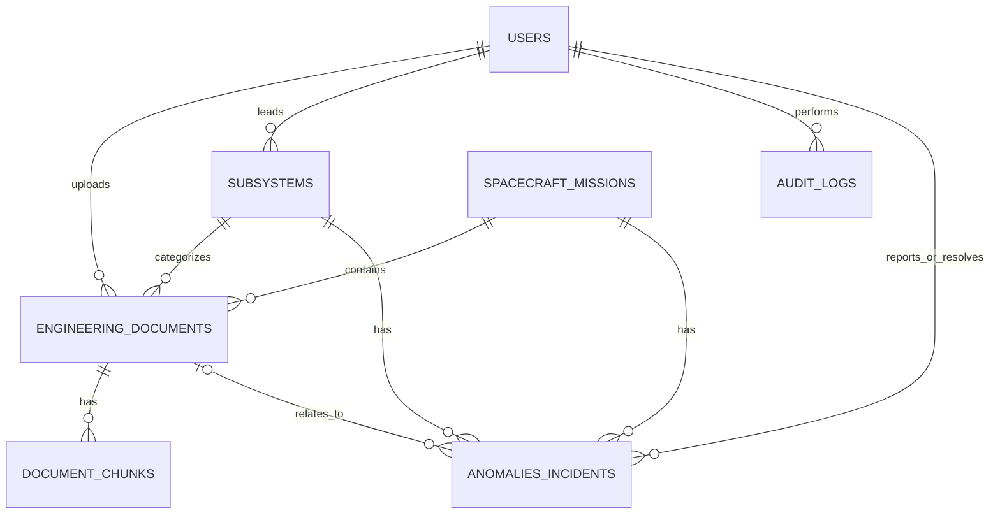

# Design and database implementation

## Problem and objectives
Spacecraft engineering documents are lengthy, fragmented and difficult to search. AstroRAG links mission, subsystem, document and incident records in a relational model, then searches indexed text chunks with pgvector and generates answers grounded in retrieved evidence. Objectives: keep relationships and audit history consistent; retrieve relevant chunks; demonstrate multiple database paradigms and advanced SQL; limit document access by role and clearance.

Scope: text ingestion, document chunking and retrieval, a server-mediated Gemini answer, account registration/sign-in, incident management, and a privileged SQL/activity view. It is not a certified mission system or production identity service. Seed mission data is illustrative, not operational authority.

## Architecture
Browser → Next.js client → Next.js route handlers → PostgreSQL + pgvector. Chat handlers first perform clearance-filtered vector retrieval, then send only eligible PUBLIC/CONFIDENTIAL excerpts and the question from the server to Google Gemini. The browser never receives the Gemini key. The storage and API are separate from the interface; the key and database connection come from server environment variables. Query output may expose document excerpts to Gemini: obtain appropriate approval.

## ER diagram

## Relational schema / data dictionary
The complete types, defaults, constraints and cascading rules are authoritative in `database/schema.sql`.
- `users(user_id PK, username UNIQUE NOT NULL, full_name, email UNIQUE, role CHECK, clearance_level CHECK, department, password_hash, is_active, created_at)`: signed-in identities. Case-insensitive uniqueness indexes also prevent ambiguous login.
- `spacecraft_missions(mission_id PK, mission_code UNIQUE, mission_name, target_body, launch_date, status CHECK, agency, budget_millions CHECK, description, created_at)`: mission master data.
- `subsystems(subsystem_id PK, code UNIQUE, name, category CHECK, lead_engineer_id FK users, criticality_level CHECK, description, created_at)`: engineering areas.
- `engineering_documents(document_id PK, mission_id FK, subsystem_id FK, title, doc_type CHECK, file_name, file_size_kb CHECK, version, clearance_required CHECK, uploaded_by FK users, status CHECK, chunk_count CHECK, created_at, updated_at)`: indexed document metadata and access label.
- `document_chunks(chunk_id UUID PK, document_id FK CASCADE, chunk_index, token_count, chunk_text, embedding vector(384), metadata JSONB, created_at, UNIQUE(document_id, chunk_index))`: text, vector and contextual metadata.
- `anomalies_incidents(anomaly_id PK, anomaly_code UNIQUE, mission_id FK, subsystem_id FK, document_id FK optional, title, severity CHECK, status CHECK, telemetry_timestamp, root_cause, mitigation_action, reported_by FK, resolved_by FK, timestamps)`: incidents and operational resolution.
- `audit_logs(log_id PK, action_type, entity_type, entity_id, user_id FK, details JSONB, timestamp)`: login, authorization and document lifecycle events.

SQL is appropriate for typed, constrained mission data and relationships. pgvector is appropriate for nearest-neighbor search over chunk representations, while retaining transactional consistency with document metadata. It is a separate vector paradigm in the same PostgreSQL server, not a separate database service.

## Vector model and retrieval
A deterministic local token/domain-weight and character-trigram hash function maps each chunk to a normalized 384-dimensional vector. It is not a pretrained semantic embedding; similarity is approximate lexical/domain similarity with possible collisions. Chunk records carry document references, chunk order and JSON metadata. The HNSW index uses `vector_cosine_ops`. The question is embedded with the same function; parameterized SQL filters by document clearance, orders by cosine distance (`<=>`), applies a 0.12 similarity threshold, and returns up to five chunks. The Gemini route excludes SECRET and TOP_SECRET material and requests source citations. Original documents are not automatically parsed from PDF/DOCX. The separately defined stored function `match_spacecraft_knowledge` demonstrates a database function; the app's access-filtered search uses its own query, not that function.

## Important DBMS examples
- `CREATE`, `DROP`, keys, constraints and B-tree/HNSW indexes: `database/schema.sql`. `ALTER` is demonstrated by migration `001` for an existing schema. **schema.sql is destructive if run directly.**
- INSERT: `ingestDocument` inserts document + chunks in one `BEGIN`/`COMMIT`, with rollback on failure. Signup and incidents also insert.
- SELECT/JOIN: `getAllDocuments` joins documents, missions, subsystems and uploader. Search joins chunks and metadata, using vector cosine distance and clearance predicates.
- UPDATE: `resolveAnomaly` changes incident status and resolver; timestamp trigger updates modified time.
- DELETE: `deleteDocument` uses clearance and foreign-key cascade for associated chunks; document lifecycle trigger writes an audit event.
- Aggregates: `severityBreakdown` uses `GROUP BY`, `HAVING COUNT(*)`, and `ORDER BY`. `getStats` uses subqueries and counts. `vw_subsystem_readiness_summary` uses lateral joins and filtered aggregations.
- Advanced features: ACID transactions, views, stored function, lifecycle and timestamp triggers, B-tree/HNSW indexes and vector similarity search.

## Conclusion and future work
The design connects relational integrity with indexed document retrieval and explainable source references. Future work: trained multilingual embeddings and reindexing strategy, PDF/DOCX parsing, persistent conversation sessions, production authentication controls, secrets management, calibrated retrieval evaluation, accessibility audit and automated integration/security tests.
